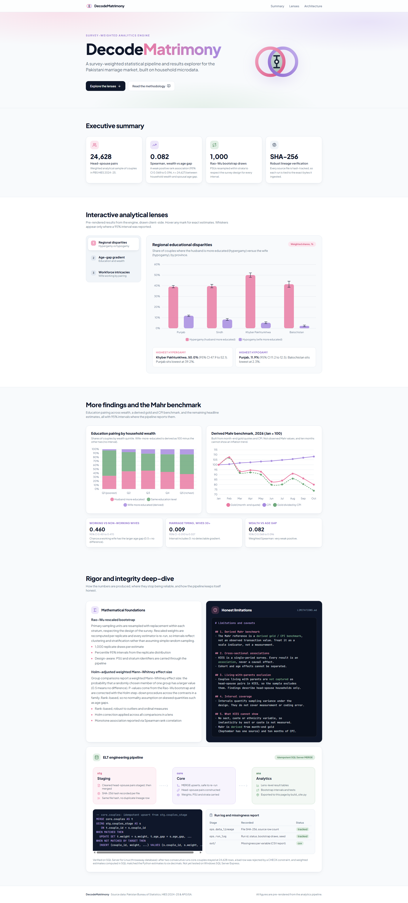

# DecodeMatrimony: Survey-Weighted Marriage-Market Analytics for Pakistan


---

# 📖 Project Overview

DecodeMatrimony is an end-to-end **data engineering and survey-statistics pipeline** that reads real household microdata from the Pakistan Bureau of Statistics and asks grounded questions about the Pakistani marriage market: who marries whom by education, how big spousal age gaps are, how wealth and wife's employment line up with both, and how a gold-and-CPI benchmark for Mahr has moved. 

Everything is **survey-weighted** and every estimate comes with a **95% interval** from a PSU- and strata-aware bootstrap, because naive tests on a clustered national survey would understate the uncertainty. 

The pipeline covers the full lifecycle: raw survey files → typed ingestion → validated cleaning with a missingness report → idempotent SQL Server ELT → six survey-weighted analytical lenses → verified results → a  static results page.

This project includes:

- 🔍 Survey-weighted, non-parametric statistics (weighted Mann-Whitney effect sizes, weighted Spearman, Holm correction)
- 🎲 Rao-Wu rescaled bootstrap that resamples PSUs within strata
- 🏠 DHS-style household wealth index (weighted PCA on housing and asset indicators)
- 💍 A **derived** gold/CPI benchmark for Mahr (clearly labelled as derived, never as observed Mahr)
- 🗄️ SQL Server ELT with MERGE upserts, constraints, file-hash lineage and run logging
- ✅ 32 unit tests and `mypy --strict`, plus a SQL-vs-Python cross-check
- 🌸 A visual results page generated straight from the pipeline output


---

## 📂 Dataset

| Feature | Details |
|---------|---------|
| Source | [Pakistan Bureau of Statistics, HIES 2024-25 microdata](https://www.pbs.gov.pk/hies/) (Stata `.dta`, public) |
| Fieldwork | September 2024 to June 2025 |
| Households | 30,123 |
| Roster rows | 184,564 (184,008 household members after dropping 556 non-members) |
| Couples analysed | **24,628** head-spouse pairs (24,631 households have exactly one head and one spouse; 3 pairs dropped because not both currently married) |
| Survey design | household weight, PSU (`prcode`), strata (first four digits of `prcode`) |
| Sanity check | Weighted literacy (age 10+) = 64.0% vs PBS published ~63% |
| Mahr benchmark inputs | Month-end APGJSA 24K gold per tola (Jan-Oct 2026, sources linked per month) and national CPI (2015-16 = 100) |

Files used: `plist_roster`, `sec_2ab_education`, `sec_1b_emp_income`, `Sec_04a_pregnancyhistory`, `sec_05m1_housingchar`. The item-level consumption file is deliberately **not** used (group-total codes are mixed in, so summing it risks double counting). Full column list and verification status: [`docs/DATA_SOURCES.md`](docs/DATA_SOURCES.md).

> No simulated or synthetic data is used in any analysis. 

---

## 🛠 Tech Stack

| Tool | Purpose |
|------|---------|
| 🐍 Python 3.11 / 3.12 | Strictly typed pipeline (`mypy --strict` clean) |
| 🐼 pandas / NumPy | Cleaning, merging, weighted statistics |
| 🔤 NLTK | Label normalisation for Stata value labels |
| 🗄️ SQL Server + SQLAlchemy + pyodbc | Idempotent ELT, constraints, lineage |
| 🧪 pytest | 32 unit and end-to-end tests |
| 🌐 Tailwind + Chart.js (CDN) | Generated static results page |
| ☁️ Google Colab | Reproducible runs and the SQL Server verification |
| 🕷️ Scrapy | Optional spider for public statistical tables (included, **not** used for the published results) |

---

## 🌸 Visual Representation


 

---

## 🔬 Analytical Lenses

|Lens | Method |
|---|---|
| Spousal age gap by wife's education | Weighted mean/median, weighted Mann-Whitney effect size vs uneducated wives, Holm-adjusted |
| Same contrast, adjusted | Stratified on wife age band × province, pooled with Wx·Wy weights |
| Wealth gradient | Weighted Spearman, plus gap and pairing shares by wealth quintile |
| Educational hypergamy / homogamy / hypogamy by province | Weighted shares with bootstrap intervals |
| Marriage-timing cohort gradient | Weighted Spearman among wives aged 30+ |
| Female workforce participation vs age gap | Weighted Mann-Whitney effect size, shares by pairing type |
| Ethnic endogamy (inelasticity proxy) | Skipped for HIES (no ethnicity, sect or caste variable): structural missingness handled explicitly |
| Mahr benchmark | Gold and CPI indexed to January 2026 = 100 (derived) |

**Method notes:** intervals are 95% percentile intervals from 1,000 Rao-Wu draws (seed `20260101`); the weighted Mann-Whitney effect is the probability a random member of one group has a larger value (0.5 = no difference); bootstrap p-values cannot go below about 1/(draws+1), so tiny ones are reported as "p < 0.001".

---

## 📌 Key Findings

> All numbers are survey-weighted, from the run in `out/results.csv` (24,628 couples). Effects are associations, not causal.

| Result | Estimate [95% CI] |
|---|---|
| Husband more educated than wife: KP / Balochistan / Sindh / Punjab | 50.0% [47.9, 52.1] / 41.4% [38.6, 44.2] / 39.7% [38.1, 41.3] / 39.2% [38.1, 40.3] |
| Wife more educated than husband: Punjab / Sindh / KP / Balochistan | 11.9% [11.2, 12.5] / 8.3% [7.5, 9.2] / 5.3% [4.4, 6.1] / 2.3% [1.6, 3.1] |
| P(larger age gap) vs uneducated wives, **adjusted**: primary / secondary / higher | 0.522 [0.505, 0.538] / 0.537 [0.525, 0.550] / 0.517 [0.498, 0.535] (Holm p = 0.026 / 0.003 / 0.103, "higher" not significant) |
| Same, unadjusted | 0.528 / 0.550 / 0.528 |
| Mean age gap in years: none / primary / secondary / higher | 4.37 [4.26, 4.47] / 4.78 [4.55, 4.98] / 5.09 [4.94, 5.24] / 4.71 [4.43, 5.01] |
| Age gap of 10+ years: poorest to richest wealth quintile | 15.1% [14.1, 16.2] to 17.9% [16.6, 19.2] |
| Wealth vs age gap (Spearman) | 0.082 [0.068, 0.096], very weak |
| Same education level, quintile 1 to 5 | 63.4% / 48.2% / 42.4% / 44.3% / 49.2% |
| Husband more educated, quintile 1 to 5 | 33.3% / 44.5% / 46.3% / 43.0% / 37.6% |
| P(larger age gap), working vs non-working wives | 0.460 [0.451, 0.470] |
| Marriage timing, wives 30+ (Spearman) | 0.009 [-0.010, 0.027], no detectable gradient |

**Highlights**

-  Education pairing differs sharply by province: KP's interval does not overlap Punjab's.
-  After adjusting for wife age band and province, the education effect on the age gap shrinks and the "higher" contrast is no longer significant.
-  The inverted U in hypergamy by wealth is largely a **floor effect**: 63% of the poorest couples share the same education level (mostly both uneducated), and wives who are more educated than their husbands rise steadily with wealth.
-  **Derived Mahr benchmark, Jan to Oct 2026 (Jan = 100):** gold 80.05 (-20.0%), CPI 108.26 (+8.3%), real value of a fixed nominal sum 92.4, real value of a fixed gold weight 73.9. Gold peaked at 107.6 in February. Ten months cannot show an inflation trend for Mahr.

---

## 🐛 Bugs Caught (and Fixed)

- **A truncation artifact:** a naive wife-age vs age-at-first-marriage correlation came out at +0.18, because young wives cannot have married later than their current age. Restricting to wives 30+ gives +0.009.
- **A household-ID collision:** a built-in reconciliation check showed `hhcode` matching on 0 rows. The true key is `prcode*1000 + hhno` (3-digit household numbers), and the fix made households reconcile exactly (30,123).
- **A gold series that could not be what it claimed:** a "monthly mean" January value was higher than any published daily quote could average to. It was replaced with documented month-end quotes, each linked to a published report.
- **Float precision:** Stata `float` columns lose precision on 11-digit codes, so identifiers are rebuilt from integers and `hhcode` is only used as a tolerance check.

---

## 🗄️ Engineering Highlights

- **Idempotent ELT:** `stg` (landing) → `core` (validated couples) → `ana` (results) plus `ops` (run log, file-hash lineage), loaded with MERGE upserts.
- **Verified on a live SQL Server:** after two consecutive runs `core.couples` stayed at 24,628 rows, lineage stayed at 1 row and `ana.results` held 102 rows (51 per run, each under its own run ID); a bad row was rejected by a CHECK constraint; weighted estimates computed in SQL matched Python to six decimals. Report: [`docs/sql_load_report.txt`](docs/sql_load_report.txt). Tested on SQL Server for Linux in a throwaway Colab database, not yet on Windows SQL Server Express.
- **Reproducibility:** all 51 results, intervals and p-values were identical on Windows and on Google Colab (Linux) with the same seed.
- **Missingness handled, not hidden:** a per-variable missingness report is written on every run; structurally absent variables skip their lens with a logged warning.

---

## 📂 Repository Structure

```text
decodematrimony/
├── config/                       # DHS and HIES column maps (verify codes against the coding scheme)
│   └── hies_roster_map.json
├── data/
│   ├── raw/                      # your downloaded survey files (git-ignored)
│   └── reference/                # small documented inputs
│       ├── gold_month_end_apgjsa_2026.csv
│       └── pakistan_cpi_2026.csv 
├── images/
│   └──overview.png
├── docs/
│   ├── DATA_SOURCES.md           # sources, checks, month-end gold links
│   └── sql_load_report.txt       # SQL Server verification output
├── notebooks/
│   ├── DecodeMatrimony_Colab.ipynb            # run the pipeline and build the page
│   └── DecodeMatrimony_SQLServer_Colab.ipynb  # live SQL Server load test
├── scripts/
│   ├── build_hies_roster.py      # merge HIES sections, build wealth index
│   ├── build_site.py             # generate site/index.html from out/
│   ├── gold_monthly.py           # recompute monthly gold from daily quotes
│   └── verify_sql_load.py        # post-load verification
├── site/
│   ├── index.template.html
│   └── index.html                
├── sql/001_schema.sql            # stg / core / ana / ops schemas
├── src/decodematrimony/
│   ├── analysis/lenses.py        # the analytical lenses
│   ├── ingest/                   # roster, DHS and Scrapy ingestion
│   ├── clean.py  db.py  logger.py  macro.py
│   ├── pipeline.py  settings.py  survey_stats.py
│   ├── textnorm.py  verify.py  wealth.py
├── tests/                        # 32 tests (in-memory fixtures only)
├── LIMITATIONS.md
├── requirements.txt  mypy.ini  pytest.ini  .env.example
└── README.md
```

---

# 🚀 How to Run the Project

1. Clone this repository.

```bash
git clone https://github.com/kazimalizaidi/decodematrimony.git
cd decodematrimony
pip install -r requirements.txt
```

2. Download the **HIES 2024-25 Stata microdata** and coding scheme from the [PBS HIES page](https://www.pbs.gov.pk/hies/) and put the `.dta` files in `data/raw/`.

3. Build the person-level roster (merges sections, builds the wealth index, prints sanity checks).

```bash
python scripts/build_hies_roster.py
```

Check that `hh_id` matches `hhcode` on every row, the two household counts are equal, and weighted literacy is near 63%.

4. Run the pipeline (add `--no-db` to skip SQL Server).

```bash
# bash
export PYTHONPATH=src DM_N_BOOT=1000
# PowerShell:  $env:PYTHONPATH = "src"; $env:DM_N_BOOT = "1000"

python -m decodematrimony.pipeline \
  --roster data/raw/hies_roster.csv --roster-map config/hies_roster_map.json --year 2024 --no-db \
  --gold-csv data/reference/gold_month_end_apgjsa_2026.csv --gold-cols Month Gold_Price_Per_Tola_24K \
  --cpi-csv data/reference/pakistan_cpi_2026.csv --cpi-cols Month National_CPI_Index --base-month 2026-01
```

Outputs land in `out/`: `results.csv`, `missingness_report.csv`, `mahr_benchmark.csv`, `run_summary.json`.

5. Build the results page.

```bash
python scripts/build_site.py      # writes site/index.html
```

6. Run the tests and the type checker.

```bash
python -m pytest -q && python -m mypy src
```

7. Optional: load into SQL Server. Create an empty database, set `DM_DB_URL` (see `.env.example`), run the pipeline without `--no-db`, then verify:

```bash
python scripts/verify_sql_load.py --results-csv out/results.csv --expect-couples 24628
```

---

## ⚠️ Limitations 

Read [`LIMITATIONS.md`](LIMITATIONS.md) before quoting any number. The short version:

- Couples are **head-spouse pairs**, so couples living in a parent's household are missed and the sample skews older.
- HIES has **no sect, caste, religion or ethnicity** variable, so that lens is skipped.
- Results are **cross-sectional associations**, never causal effects.
- "Working" follows the broad employment question (it includes unpaid family work); wealth is an asset-based PCA index, not consumption.
- Mahr is **derived from gold and CPI**, not observed; ten months cannot show an inflation trend. September's gold quote has one source only.

---

# 📌 Future Improvements

- Cross-check with the **PDHS 2017-18** couples file (needs DHS approval) to test whether findings agree across surveys
- Extend the Mahr benchmark back several years, with a second source for every gold quote
- Adjust the age-gap comparison for urban/rural and add cohort-specific models
- Test the SQL load on Windows SQL Server Express
- Add a GitHub Actions workflow (tests and `mypy --strict`) and a Dockerfile for one-command reproduction
- Compile the page's CSS instead of using the Tailwind CDN for a production site

---

# 📚 References & Data Sources

- **Survey data:** [Pakistan Bureau of Statistics, Household Integrated Economic Survey 2024-25](https://www.pbs.gov.pk/hies/)
- **CPI:** Pakistan Bureau of Statistics, national CPI general index (base 2015-16 = 100)
- **Gold:** month-end APGJSA 24K per-tola quotes as reported by named outlets, linked month by month in [`docs/DATA_SOURCES.md`](docs/DATA_SOURCES.md)
- **Method:** Rao-Wu rescaled bootstrap for stratified cluster samples; DHS-style wealth index (weighted PCA)

---

# 🎧 Project Soundtrack

*This track was on loop while working on this project*

[Chemtrails Over The Country Club - Lana Del Rey](https://open.spotify.com/track/7bPWdJgx8vek7S5i5yAtvG?si=dd05bbf82fb1456a)

**Star this repository if you found it interesting!** ⭐

made with ❤️ by **kazim**
